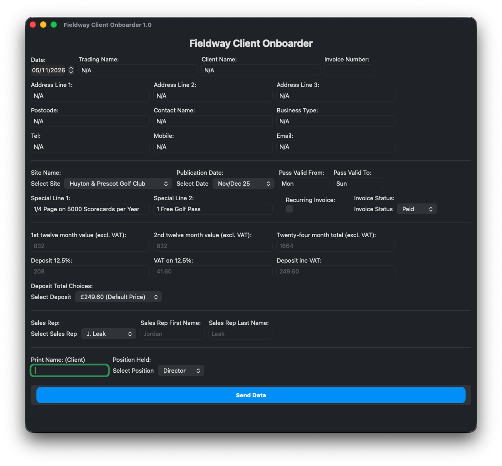
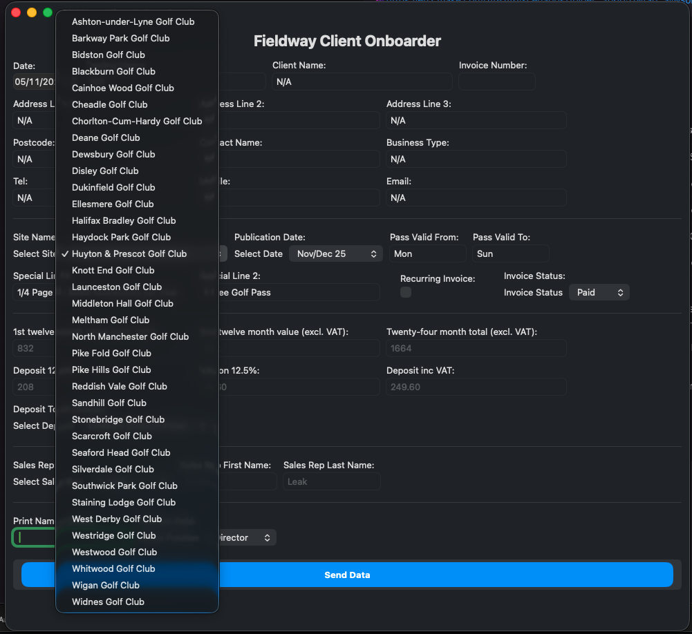
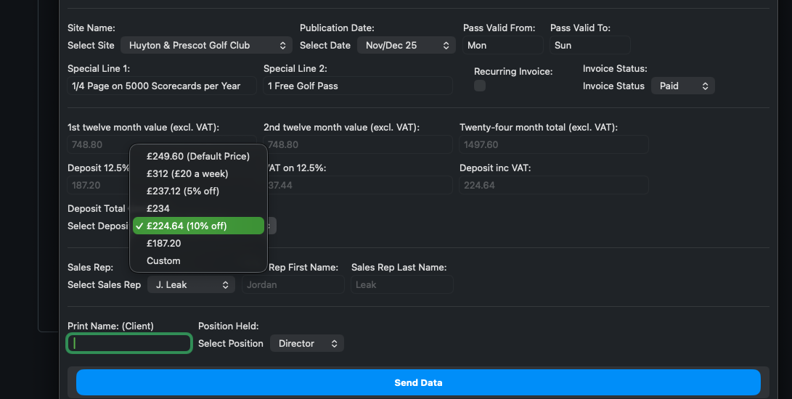
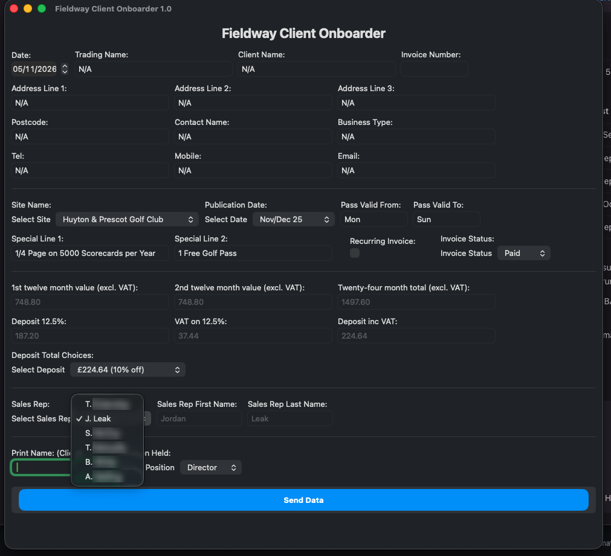
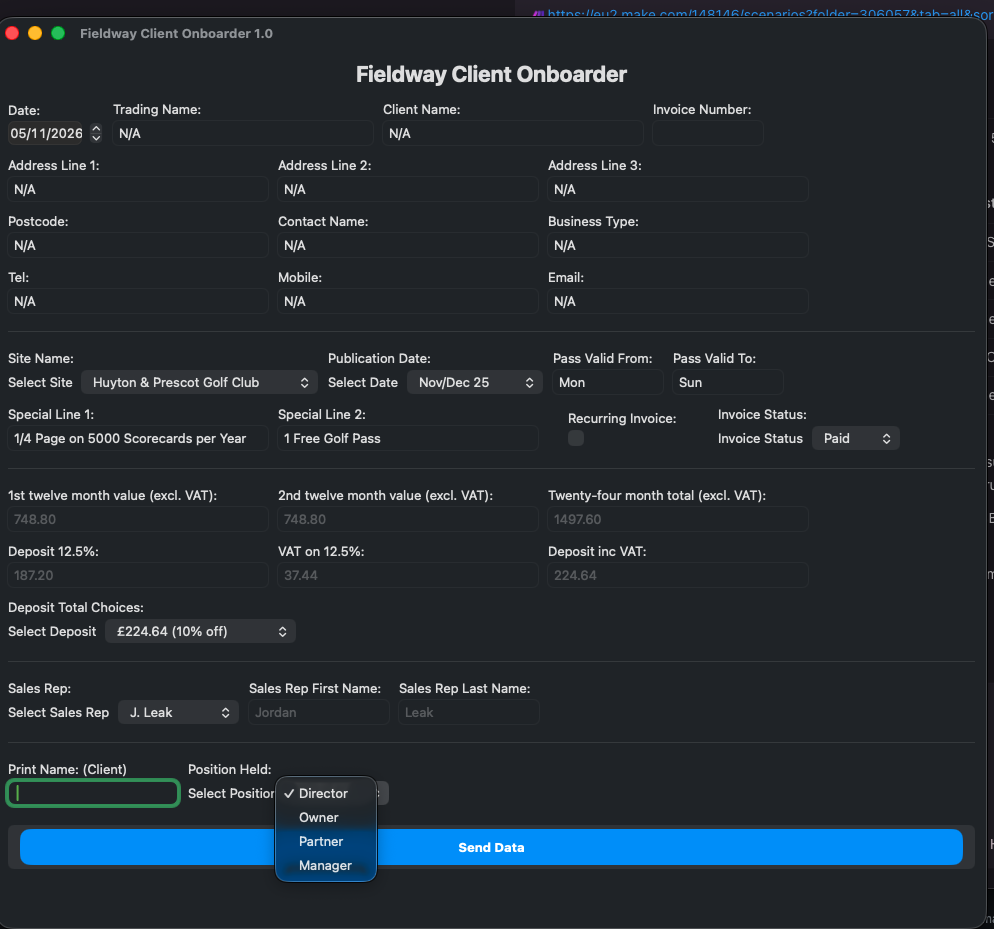
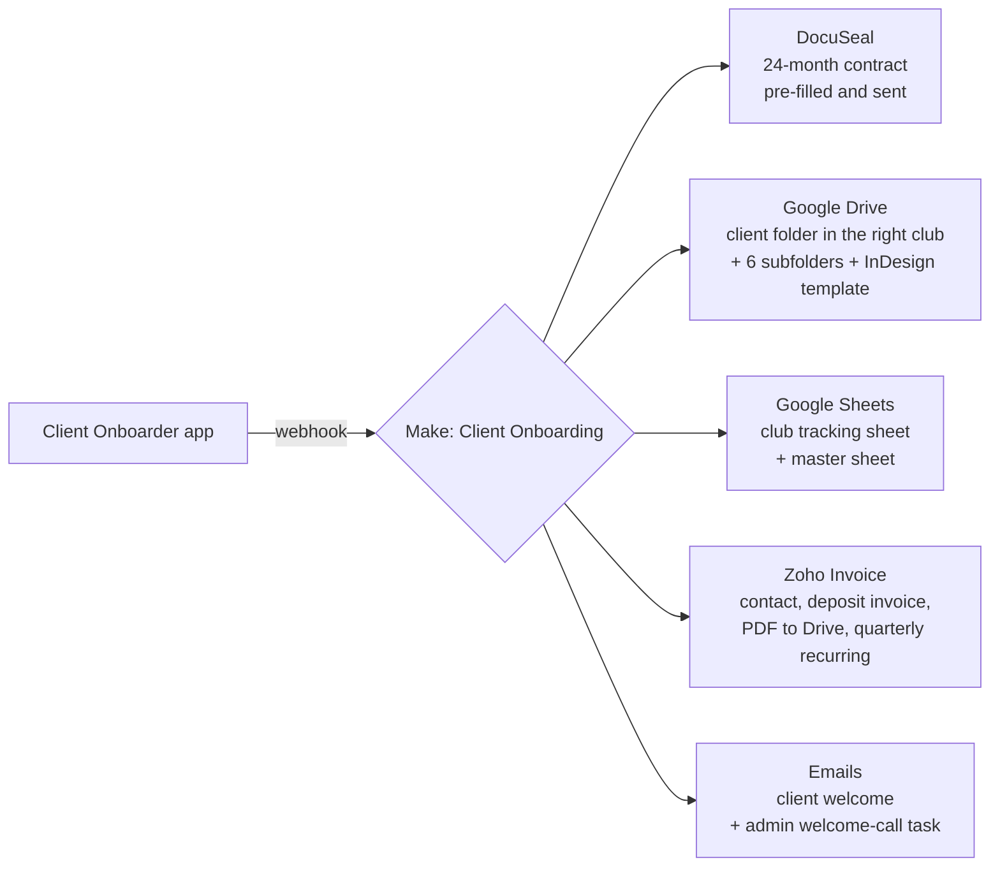

# Fieldway Advertising: Sales & Admin Automation

**Built by:** Jordan Leak  
**Role:** Sales Executive, plus automation, telesales management and lead generation  
**When:** 2024, about a year and a bit  
**Tools:** Make.com, DocuSeal, Zoho Invoice, Google Drive, Google Sheets, Airtable, Dialpad, a custom desktop app

Fieldway Advertising sells advertising space at golf clubs across the UK: adverts on scorecards, with golf passes included. A deal goes from a phone call to a signed 24-month contract, an invoice and a design job for the in-house graphics team.

This was one of my first real automation projects. I was cold calling and closing deals myself at the time, so I knew the admin process first-hand and could see where hours were going.

---

## The problem

Every closed deal set off the same manual checklist for the admin team:

- Type the client's details into a contract and send it for signing
- Create the client's folder (and subfolders) in the right golf club's area of Google Drive
- Add the client to that club's tracking sheet *and* to the master sheet
- Create the customer and deposit invoice in Zoho, email it, save the PDF to Drive
- Set up the recurring invoice where needed
- Send the client a welcome email and book a welcome call
- Work out which rep made the sale, and what they were owed

The same details were typed in five or six times, by hand, for every deal. Sales reps also kept asking the boss *"Has my client signed yet?"* so they could claim commission.

## The constraint

I couldn't replace the business's systems. Zoho, Google Drive, the spreadsheets and the folder layout the designers relied on all had to stay as they were. My job was to **plug into the existing workflow and take out the repeated typing**, not to rebuild it.

### Why Make.com

I chose Make on purpose so the **admin staff could maintain it themselves**. Its visual editor lets non-developers see each step, change an email template, add a golf club or fix a broken connection without needing me. That meant the business didn't depend on one person to keep its automations running, which mattered more than technical neatness.

With a clean slate I would have designed some of it differently (see [What I'd do differently](#what-id-do-differently)).

---

## The solution

### 1. The Client Onboarder (desktop app)

A small desktop form that the admin team filled in once per deal. It works out the money automatically and sends everything to Make with one **Send Data** click.

  

What it handles:

- **Client and business details**: trading name, contact, address, phone, email, business type
- **Site picker**: a dropdown of every golf club Fieldway sold at, so names always matched the Drive folders and sheet tabs exactly
- **Contract maths**: from the yearly value it calculates the 24-month total, the 12.5% deposit, VAT on the deposit, and the deposit including VAT
- **Deposit presets**: standard price, "£20 a week", 5% off, 10% off or custom. Picking one works the whole contract value back from that deposit, so reps could offer a discount without anyone redoing sums
- **Sales rep and signatory**: who made the sale (used for commission) and the client's role (Director, Owner, Partner, Manager)
- **Invoice options**: recurring invoice on or off, and invoice status

| Site picker | Deposit presets |
|---|---|
|  |  |

| Sales rep | Client position |
|---|---|
|  |  |

### 2. Client Onboarding (Make.com scenario)

The app sends the form to a Make webhook. A single scenario of **about 400 modules** then runs the whole new-client checklist:

Step by step:

1. **Contract.** Builds a DocuSeal submission from the form data: client details, site, publication date, pass validity, deposit, VAT, total and sales agent. The client gets a ready-to-sign 24-month contract within seconds of the call ending.
2. **Design folders.** Routes on the chosen golf club (18 clubs were wired in), creates the client's folder inside that club's Drive area, adds the standard subfolders the graphics team used (`Approval_Admin`, `ArtworkFiles`, `Assets`, `Emails`, `Export`, `Proofs`) and copies in the InDesign advert template. Designers could start straight away.
3. **Tracking sheets.** Adds the client to the club's own tab in the Artwork Proof Record. The row added to the master sheet is made of **live formulas pointing at that club row**, so the master sheet updates itself whenever the club sheet is edited.
4. **Invoicing.** For new invoices it creates the customer in Zoho, raises the deposit invoice (tagged with the salesperson), emails it to the client and saves the PDF to the client's Drive folder. If "Recurring Invoice" was ticked, it also sets up a **quarterly recurring invoice**.
5. **Hand-off emails.** Sends the client a branded welcome email introducing their artwork contact and asking for logos and assets. It also emails the admin team a to-do for the welcome call, with a checklist of what the automation had already done and what was still left.

### 3. DocuSeal Signed Alert

A webhook fires when a client signs. Make gets the full submission from the DocuSeal API and emails **only the sales rep on that deal, plus management**. The email includes:

- Client name, business, golf club and contact details
- Deal value
- **The rep's commission, calculated automatically**

Reps stopped chasing the boss to find out whether a contract had been signed, and commission figures came out consistent every time.

### 4. DocuSeal Scrape → Airtable CRM

Runs every 15 minutes. It pages through DocuSeal submissions, picks out the client signer, tidies the golf club name with a regex, and adds the deal to the sales CRM in Airtable as **"Deal Done"**, with signed date, contact details and site. The CRM stayed up to date without anyone re-keying deals.

### 5. Daily Call Reports (Dialpad → Airtable)

I also managed the telesales team, so I built reporting for it. Every weekday at **13:00 and 17:00**, Make:

1. Gets the active users from the Dialpad API
2. For each rep, pulls every call since the start of the working day, paging through the API results
3. Writes each rep's call count to an Airtable call tracker

That gave us a midday check-in and an end-of-day figure for every rep, with no manual counting.

---

## Impact

- **One form instead of six or more systems.** Deal details were entered once and sent everywhere they were needed.
- **Contracts went out in seconds**, while the client was still warm from the call.
- **Designers got a ready-made folder and template** for every new client.
- **Invoices, PDFs and recurring billing** were created the same way every time.
- **Commission was clear.** Reps were told automatically when their deal signed and what they had earned.
- **Telesales activity was visible** twice a day without anyone counting calls by hand.

---

## What I'd do differently

This was an early project and it shows in places. Knowing what I know now:

- **Use a lookup, not 18 copies.** Each golf club had its own copy of the same branch (~20 modules × 18 clubs). Today I'd keep club → folder ID / sheet tab in one data store or sheet and run a single branch. Adding a club would then be one new row, not another cloned branch.
- **Loop through pages properly.** The call reports copy the API pagination step four times per rep. A repeater or iterator would handle any number of pages for any number of reps.
- **Keep secrets in connections.** Some API keys sat directly in HTTP modules. I'd move them all into Make connections or keys.
- **Add error handling and alerts**, so a failed Zoho or Drive step tells someone instead of failing quietly.
- **Rethink the stack where allowed.** With a free hand I'd have merged the spreadsheets, CRM and invoicing into fewer systems instead of linking them all together.
- **Build it in-house.** My own preference is code I control: a Python service running on the company's own server or a VPS, with the settings in version control, proper logging and tests. It costs nothing per operation, keeps client data off third-party automation platforms, and can be tested before changes go live. Make was the right call for a team that needed to edit it themselves, but for a business with a developer to look after it, I'd build it this way.

---

## The wider role

The automations were only part of the job. While I was there I also:

- **Cold called and closed deals** myself, as a Sales Executive
- **Ran Meta ads** and built an **inbound lead campaign**, then closed the leads it brought in
- **Managed the telesales team**, including their CRM and the calling data
- **Wrote scripts for the graphics team** and other small tools to save the telesales team time (not all of them are documented here)

> Some of my automations were handed over when I left, and I no longer have access to them. This page covers the ones I still could document. They have all been switched off since I left.
